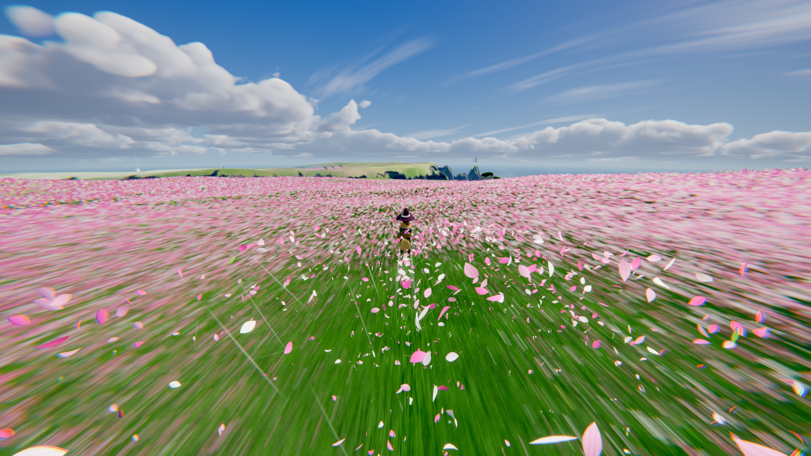
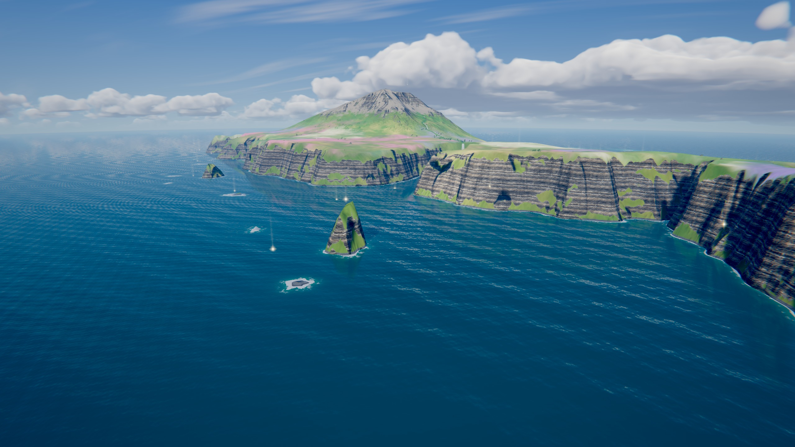
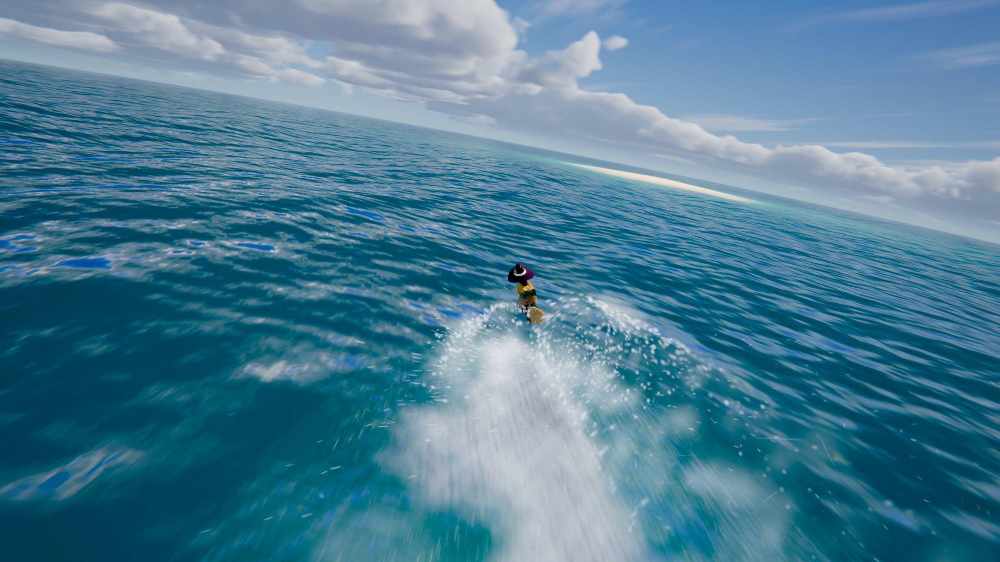
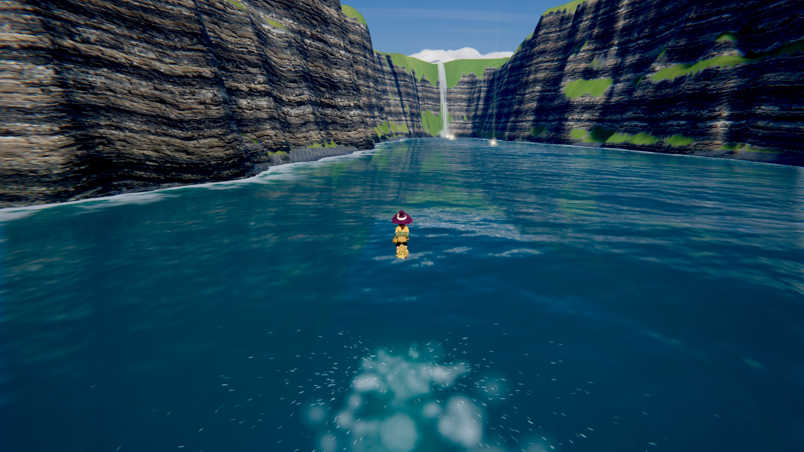
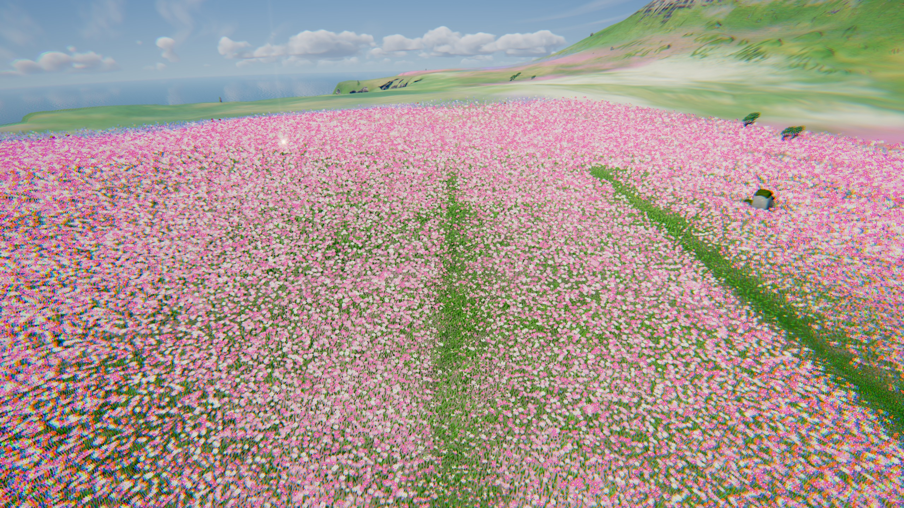
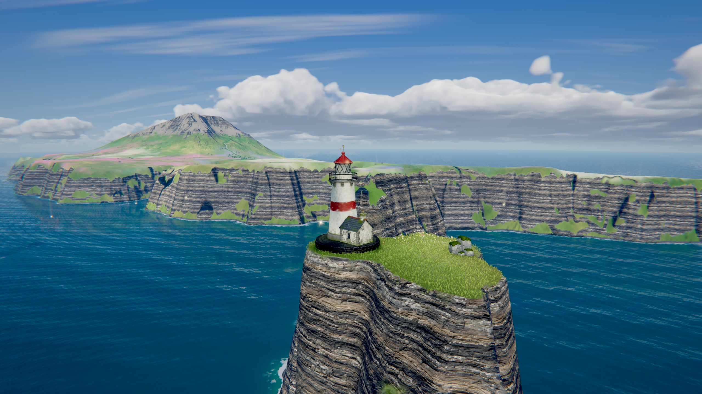
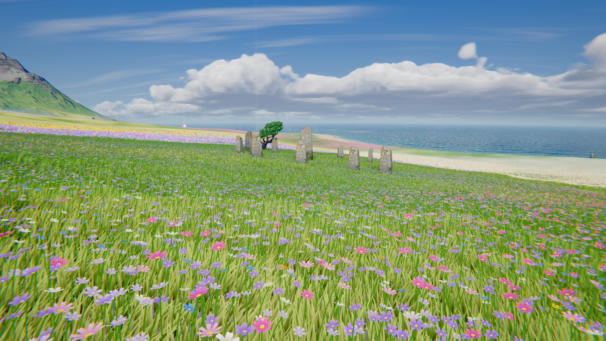

Warning: Complete slop. I haven't read a single line of this repo. -Jacob

# Petalwake

*A broom, an island, a good wind.*

Petalwake is a small browser game about flying low and fast over flower meadows, sea cliffs and
open water, and about what the air does behind you. The broom sheds a simulated pair of wake
vortices, and the world answers to them: petals are wound up and carried along, grass is laid
over, spray is torn off the sea, and the flowers you pass are left with fewer petals, the faster
you went by.

**Play it: <https://petalwake.non.io>** (a desktop browser with WebGL2; the first load is about 48 MB)



<p>
  
  
  
  
  
  
</p>

## Controls

| | |
|---|---|
| <kbd>W</kbd> <kbd>S</kbd> or <kbd>↑</kbd> <kbd>↓</kbd> | dive, climb |
| <kbd>A</kbd> <kbd>D</kbd> or <kbd>←</kbd> <kbd>→</kbd> | bank |
| <kbd>Shift</kbd> | ride the gust (boost) |
| <kbd>Space</kbd> | ease up (brake) |
| Mouse | click the view to steer with it; left button boosts, right button brakes |
| <kbd>C</kbd> | camera: chase, low, far |
| <kbd>I</kbd> | invert pitch |
| <kbd>P</kbd> | hide the HUD |
| <kbd>M</kbd> | mute |
| Gamepad | left stick steers, right trigger or A boosts, left trigger or B brakes |

There is no way to fail. A dive rounds itself out and lands with a bounce, walls push you off, and
the wind turns you home if you wander too far out to sea. Glowing wind seeds are scattered along
the island's best lines; catching one tops up the gust.

## Run it locally

There is no build step: the page loads ES modules straight from `src/`.

```bash
python3 tools/serve.py
```

Then open <http://localhost:6280>. Any static file server works just as well (it has to be served
over HTTP; opening `index.html` from disk will not load the modules).

Options in the URL: `?q=low|medium|high` sets the meadow density, `?dpr=1.5` sets the pixel ratio,
`?noscale` turns off the automatic resolution scaling, `?play` skips the title screen.

It has been developed and checked in Chrome only.

## How it works

Everything is vanilla JavaScript on [three.js](https://threejs.org) r187 (WebGL2), with custom
shaders for nearly all of it.

- **The wake** ([src/fx/vortex.js](src/fx/vortex.js)). A ring of 256 cross-sections is laid down
  behind the broom, each holding a counter-rotating pair of vortex cores. The cores drive each
  other and their mirror images under the ground, so the pair sinks and then runs apart along the
  deck; they fatten and weaken with age, drift on the wind, and are shed unsteadily so no two
  stretches are alike. The ring starts tight at the broom and opens up behind it.
- **What the wake does.** Particles (petals, leaves, spray, grit) sample the vortices on the CPU
  ([src/fx/particles.js](src/fx/particles.js), [src/fx/windfx.js](src/fx/windfx.js)). The same
  trail is drawn as a ribbon into two top-down maps: a scrolling field that grass, flowers, trees
  and water read to lean, thrash and foam ([src/fx/wake.js](src/fx/wake.js)), and an island-wide
  map of how many petals each spot has lost ([src/fx/strip.js](src/fx/strip.js)).
- **The meadow** ([src/world/meadow.js](src/world/meadow.js)). Grass and flowers are placed on the
  GPU around the camera. Flowers form one continuous field that thins by rank with distance, and
  drop their petals one at a time as the map above fills in.
- **The island** ([src/world/terrain.js](src/world/terrain.js),
  [tools/terrain/bake.py](tools/terrain/bake.py)). A 6 km square heightfield, 4096 samples a side,
  baked offline: stratified sea cliffs, a fjord, droplet erosion, a river and its waterfall, flower
  drifts, and the light and shadow maps. It is drawn as a CDLOD quadtree with stochastic texture
  sampling to hide tiling.
- **Sea, river, sky** ([src/world/water.js](src/world/water.js),
  [src/world/river.js](src/world/river.js), [src/world/clouds.js](src/world/clouds.js)). Gerstner
  swell with shore surf and reflections; ray-marched clouds baked into a sky texture at load.
- **Flight and camera** ([src/player/flight.js](src/player/flight.js),
  [src/player/camera.js](src/player/camera.js)). An arcade model tuned for skimming; the chase
  camera closes in when you slow down and pulls back when you sprint.
- **Frame** ([src/core/pipeline.js](src/core/pipeline.js)). HDR with MSAA, camera motion blur with
  the rider and particles drawn sharp on top, bloom, god rays, a light lens pass and tonemapping.
- **Sound** ([src/audio/audio.js](src/audio/audio.js)). Synthesised in the browser; no audio files.

## Layout

```
index.html          the page, the title screen and the HUD
src/                the game
  core/             shared uniforms, the frame pipeline
  world/            terrain, meadow, water, river, sky, clouds, props, seeds
  player/           flight model, camera, input, the rider
  fx/               wake vortices, wake maps, particles, wind effects
  shaders/          GLSL shared by every material
  audio/            procedural sound
assets/             what the game loads: baked terrain, models, textures
vendor/three/       three.js r187, copied unmodified from the npm package
tools/
  serve.py          dev server (no caching, optional frame capture)
  terrain/bake.py   builds everything in assets/terrain
  gen/              concept art, models and materials from fal and Meshy
  blender/          turns generated meshes into game assets
screenshots/
```

## Rebuilding the island

The world is defined in `tools/terrain/bake.py`; change it there, not in the game.

```bash
python3 -m venv tools/.venv
tools/.venv/bin/pip install -r tools/requirements.txt
tools/.venv/bin/python tools/terrain/bake.py 4096 --keep-props
```

A bake takes a little over a minute. `--keep-props` keeps trees, stones and boulders where they
are; leave it off to scatter them afresh.

## Regenerating the art

The rider and the props were generated, not modelled by hand: concept images from fal
(`nano-banana-pro`), meshes from Meshy (`meshy-7.1`, image to 3D), ground and rock materials from
fal (`patina`), then cleaned up, weighted for wind and exported with the Blender scripts. The
scripts in `tools/gen` read `FAL_KEY` and `MESHY_API_KEY` from the environment. Their raw output
goes to `art/`, which is not in this repository (it is about 250 MB); the processed results in
`assets/` are.

## License and credits

Petalwake is released under the MIT License: see [LICENSE](LICENSE).

- [three.js](https://threejs.org) r187, MIT. See [vendor/three/LICENSE](vendor/three/LICENSE).
  It bundles the meshoptimizer decoder (MIT, Arseny Kapoulkine).
- Fraunces and Karla, loaded from Google Fonts, SIL Open Font License.
- Models and materials generated with [Meshy](https://www.meshy.ai) and [fal](https://fal.ai).

## How it was made

Petalwake was built in a day with [Claude Code](https://claude.com/claude-code) (Claude Fable 5.2)
from a short brief and a reference clip for the mood, then tuned over a few rounds of play-testing
notes. The code, the shaders, the terrain bake and the asset pipeline were written by the model;
the art was generated with the services credited above.
